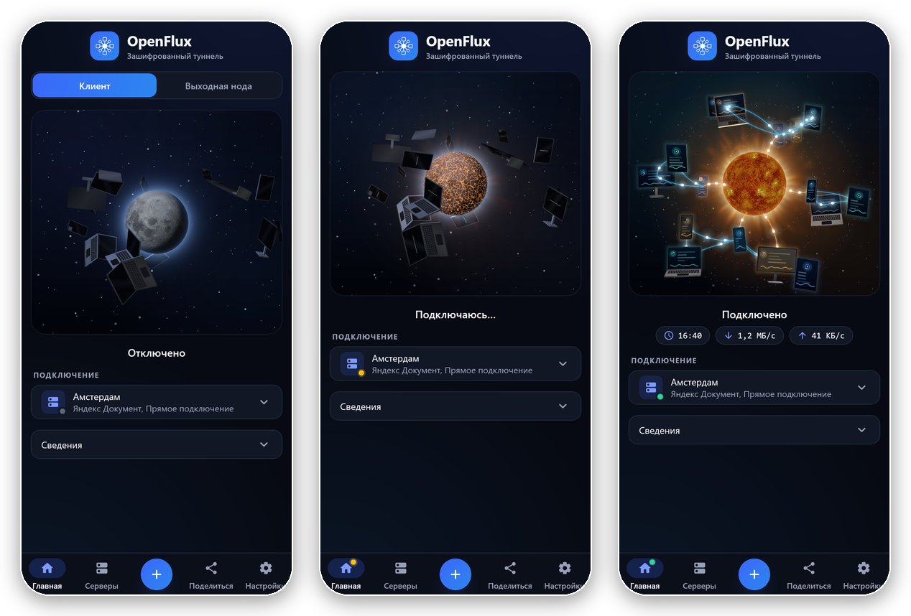

<p align="center">
  
</p>

<h1 align="center">OpenFluxAndroid</h1>

<p align="center">
  The OpenFlux client for Android.<br>
  A tunnel that rides on ordinary web services, with automatic failover between them.
</p>

<p align="center">
  <a href="../../releases/latest"></a>
  <a href="LICENSE"></a>
  
</p>

<p align="center">
  <b>English</b> · <a href="README.ru.md">Русский</a>
</p>

<p align="center">
  <a href="https://github.com/OpenFluxTeam/OpenFlux">Core</a> · <a href="https://github.com/OpenFluxTeam/OpenFluxDesktop">Desktop</a> · <a href="https://github.com/OpenFluxTeam/OpenFluxAndroid">Android</a> · <a href="https://testflight.apple.com/join/BwnAcdus">iOS (TestFlight; the App Store release is coming)</a>
</p>

<p align="center">
  
</p>

## What it is

OpenFluxAndroid is the Android app of [OpenFlux](https://github.com/OpenFluxTeam/OpenFlux). The core is built into the APK and runs inside the app. Traffic goes through a **transport**: a document on a web service (Yandex, Mail.ru, cups.online, Avito, Telemost, MAX) or a plain TCP connection to your own node. A profile can hold several transports; the app switches between them by priority when one stops working.

## The switch

<p align="center">
  
</p>

The connect button is a small universe. While the app is off, the Moon turns slowly in the middle and phones, tablets, laptops and monitors drift round it with their screens dark. Press it: while the connection is being set up, the Moon's crust cracks with fire; once it is up, the Moon burns into the Sun, the screens light up as its light reaches them, the devices settle into orbits, and links of light join them to each other and to the Sun, with traffic running along them, faster when the connection carries more. Disconnect and it all plays back; a failed connection flares red. The Moon and the Sun are real: NASA's LRO map of the Moon and the Sun's surface seen by the Solar Dynamics Observatory, drawn by a shader on the GPU.

<p align="center">
  
</p>

## Features

- **A new look.** Deep navy and one blue accent, as in 2.x, with soft light and motion everywhere; dark and light themes.
- **A system VPN or a local SOCKS5 proxy.** The VPN carries the whole phone; the proxy is for apps you point at it yourself.
- **Several transports in one profile**, each with a priority and the network it may use (mobile data, Wi-Fi). When the best one fails, the next takes over.
- **Encryption.** AES-256-GCM end to end with a key you set; a profile with a key hides the traffic from the service that carries it.
- **A node in a few taps.** The wizard installs an exit node on your server over SSH, or sets one up on ordinary PHP hosting with no server at all. The node updates itself and rolls back if an update does not start.
- **Share by link or QR.** An `openflux://` link carries a whole profile; the camera scans it back in.
- **A built-in browser** for the checks some services ask for (SmartCaptcha, a login wall).
- **This phone as a node**, so other devices can connect through it.
- **A quick-settings tile** to connect and disconnect without opening the app.
- **Updates from GitHub releases**, checked against the release's `SHA256SUMS.txt`, installed only when you agree.

<!-- team:start -->
## What is new in the current release

The release **3.9** carries the OpenFlux core 0.14, built into the APK (unchanged since 3.8).

- **A new look.** The 2.x palette is back and richer: deep navy, one blue accent with soft light, motion on every control, a pill under the chosen place in the bottom bar.
- **The switch.** Home's button is the Moon that burns into the Sun, with the devices round it waking and joining the network: see [The switch](#the-switch). Android 13 and later draw it with a shader; older versions from pictures.
- From 3.8: **direct first** (a plain TCP connection to the node ahead of the documents while it is alive), **speed** work (large packets, pooled buffers, Reno on direct streams), **stripe groups** in the core, and **a restarted node is taken over at once**.

The full list is in [CHANGELOG.md](CHANGELOG.md).
<!-- team:end -->

## Install

Download an APK from the [releases page](../../releases/latest): the universal one, or the one for your processor (`arm64-v8a` for most phones, `armeabi-v7a` for older ones, `x86` and `x86_64` for emulators). Allow installing from the browser or file manager you used.

## Build from source

Needs JDK 17, Go, the Android SDK with NDK 27, and `gomobile` (`go install golang.org/x/mobile/cmd/gomobile@latest`).

```bash
git clone --recurse-submodules https://github.com/OpenFluxTeam/OpenFluxAndroid.git
cd OpenFluxAndroid
scripts/build-android-core.sh          # builds androidApp/libs/openflux.aar from the OpenFlux/ submodule
./gradlew :androidApp:assembleDebug    # the APK, split per ABI
```

Already cloned without `--recurse-submodules`? Run `git submodule update --init --recursive`. `scripts/build-android-core.sh ../OpenFlux` builds against a separate checkout instead of the submodule. Rebuild the AAR whenever the core's Go API or the `OpenFlux/` submodule changes.

## Structure

```
androidApp/   VPN service, the WebView check flow, the camera (QR), settings
shared/       Submodule: models, service interfaces, design system, screens
OpenFlux/     Submodule: the core (CLI and the mobile/ gomobile bridge)
scripts/      build-android-core.sh
```

The same screens run on the desktop in [OpenFluxDesktop](https://github.com/OpenFluxTeam/OpenFluxDesktop); both use the module [OpenFluxClientShared](https://github.com/OpenFluxTeam/OpenFluxClientShared).

<p align="center">
  
</p>

## Credits

- **[meepo161](https://github.com/meepo161)** — author of [OpenFluxClient](https://github.com/meepo161/OpenFluxClient), the source of this app's UI and logic (`androidApp/`, `shared/`): multi-transport sessions with failover, encryption, the in-app check flow, the node wizard and the Compose design system. Thank you!
- **[p1neappleXpress](https://github.com/p1neappleXpress)** — author of the [OpenFlux](https://github.com/p1neappleXpress/OpenFlux) core this app embeds: the tunnel, the transports and the negotiation protocol.

The previous, simpler single-transport app that lived in this repository is kept at the [`legacy-native-app`](../../tree/legacy-native-app) tag.

## License

GNU General Public License v3.0 or later — see [LICENSE](LICENSE).
